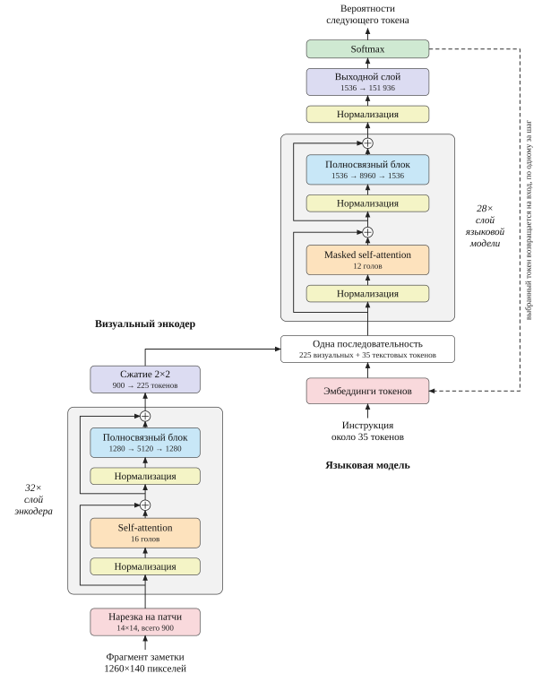

# Qwen2-VL-2B на iPad с M1

Домашнее задание №1 по курсу «Дистилляция и ускорение моделей», ИПИИ НИУ ВШЭ.

## 1. Модель и сценарий применения

**Модель.** Qwen2-VL-2B [1] это языковая модель с визуальным входом от Alibaba (2024 год). На вход она получает картинку и текстовую инструкцию, на выходе пишет текст. В семействе есть ещё версии 7B и 72B, я беру самую маленькую.

**Задача.** Человек пишет стилусом конспект: текст, формулы, списки. Модель переводит написанное в аккуратный Markdown, а формулы в LaTeX.

**Почему не встроенное распознавание почерка.** В iPadOS оно есть и на обычном тексте наверняка быстрее, но возвращает просто строку символов. Мне нужна структура: формулы, списки, заголовки.

**Сценарий.** Только инференс, онлайн, на самом устройстве. Обучение здесь не рассматривается (кроме дообучения в разделе 6).

| Параметр нагрузки | Значение |
|---|---|
| Пользователи | один, запросы идут строго по очереди |
| Частота запросов | один раз на дописанную строку, примерно раз в 5-15 секунд |
| Вход | фрагмент страницы со свежей строкой, 1260×140 пикселей |
| Выход | около 30 токенов (одна рукописная строка) |
| Время ответа | первые символы ≤ 1 с, вся строка ≤ 2 с |

Требования ко времени мои собственные: если текст появляется позже чем через пару секунд, человек уже пишет следующую строку.

## 2. Целевая аппаратная платформа

Беру **iPad Air 5-го поколения (2022) на чипе M1** [5]. Железо сознательно не новое: конспекты пишут на том планшете, который есть, а не на последнем iPad Pro. M1 с 8 ГБ выглядит как нижняя планка, на которой задача вообще решаема.

| Характеристика | Значение | Что это значит для модели |
|---|---|---|
| GPU | 8 ядер, 2,6 трлн операций/с по паспорту [4] | Потолок скорости для энкодера и обработки входа |
| Neural Engine | 16 ядер, 11 трлн операций/с по паспорту [4] | Отдельный ускоритель для нейросетей, в расчётах на него не закладываюсь (см. 6.4) |
| Память | 8 ГБ, общая для CPU и GPU [5] | Модель делит её с системой и приложением для заметок |
| Скорость памяти | около 68 ГБ/с [6] | Потолок скорости генерации текста |
| Охлаждение | пассивное, без вентилятора | При долгой нагрузке чип сбрасывает частоту |
| Батарея | 28,6 Вт·ч [5] | Модель работает всё время, пока человек пишет |
| Экран | 2360×1640, 264 точки на дюйм [5] | Строка во всю ширину занимает больше 1600 пикселей, для модели её приходится уменьшать |

Я закладываю бюджет не больше 3 ГБ на модель.

## 3. Архитектура модели

Схема читается снизу вверх. Слева визуальный энкодер, справа языковая модель. Размерности сверены с `config.json` [2], число параметров пересчитано по ним вручную.

| Блок | Устройство | Параметры |
|---|---|---|
| Визуальный энкодер (ViT) | 32 слоя, размерность 1280, 16 голов, патч 14×14 | ≈ 630 млн |
| Сжатие токенов | склеивает 2×2 соседних патча в один токен, MLP 5120 → 1536 | ≈ 34 млн |
| Языковая модель (Qwen2-1.5B) | 28 слоёв, размерность 1536, 12 голов, полносвязный блок 8960 | ≈ 1,54 млрд (из них 233 млн занимает таблица эмбеддингов) |
| **Всего** | | **≈ 2,2 млрд** |

**Как это работает.**

1. **Энкодер.** Картинка режется на квадратики 14×14 пикселей, каждый проходит через 32 слоя трансформера. В каждом слое attention полный: каждый патч «смотрит» на все остальные.
2. **Сжатие.** Четыре соседних патча склеиваются в один токен.
3. **Языковая модель.** Получает визуальные токены вместе с токенами инструкции и пишет ответ по одному токену. Промежуточные результаты хранятся в кэше ключей и значений.

Слой в обоих блоках устроен одинаково: нормализация, attention, сложение с обходной связью (кружки с плюсом на схеме), потом снова нормализация, полносвязный блок и ещё одно сложение.

**Главная особенность модели: динамическое разрешение.** Картинка не приводится к фиксированному размеру. Число визуальных токенов зависит от размера входа:

> токенов = (высота / 28) × (ширина / 28), от 4 до 16 384

Для мелкого текста это хорошо, но стоимость запроса зависит от размера картинки.

**Самые ресурсоёмкие части:**

- **По вычислениям: энкодер.** Он обрабатывает патчи до сжатия, то есть вчетверо больше элементов, чем языковая модель. Слой у него легче, поэтому работы выходит примерно вдвое больше.
- **По памяти: языковая модель.** На неё приходится 70 % всех параметров.
- **По времени: генерация.** Каждый токен требует отдельного прохода по всей языковой модели.

Внутри слоя языковой модели **88 % параметров сидит в полносвязном блоке**, а не в attention (41,3 млн против 5,5 млн): ключи и значения в attention считаются всего для 2 голов вместо 12.

## 4. Вычислительные затраты и узкие места

### Как я считаю

Все числа ниже получены расчётом по конфигурации модели [2] и характеристикам чипа [4, 5], а скорость GPU и памяти откалибрована по публичному бенчмарку llama.cpp на M1 [6]. Точность таких прикидок примерно плюс-минус в полтора раза.

Операции считаю так: одно умножение со сложением это 2 операции. Триллион операций обозначаю T.

- **Энкодер:** 2 × параметры слоя × число патчей × 32 слоя, плюс attention: 4 × (число патчей)² × 1280 × 32. Первое слагаемое растёт линейно с размером картинки, второе квадратично.
- **Обработка входа языковой моделью:** 2 × 1,31 млрд × (визуальные токены + токены инструкции). Здесь тоже есть квадратичное слагаемое attention, но на строке оно ничтожно (0,01 T), а на странице добавляет 1,3 T.
- **Генерация:** по вычислениям те же 2 × параметры на токен. Скорость ограничена памятью: на каждый токен нужно прочитать все веса, поэтому токенов в секунду ≤ скорость памяти / размер модели в байтах.

**Калибровка.** В бенчмарке llama.cpp [6] модель Llama 7B на M1 обрабатывает вход со скоростью 118 токенов/с, а генерирует 14 токенов/с при 4 битах на вес.

- 118 × 6,74 млрд × 2 ≈ 1,6 T/с. Это около 60 % от паспортных 2,6. **Беру 1,5 T/с.**
- Модель в 4 битах весит 3,8 ГБ, значит потолок по памяти равен 68 / 3,8 ≈ 18 токенов/с. Реально выходит 14, то есть около 80 % от потолка. **Беру коэффициент 0,8.**

### Что получилось

Считаю два входа: строку (1260×140, 900 патчей, 225 токенов, ответ 30 токенов) и для сравнения целую страницу (1260×1680, 10 800 патчей, 2700 токенов, ответ 500 токенов). Модель в исходной точности FP16.

| Этап | Строка: вычисления | Строка: время | Страница: вычисления | Страница: время | Чем ограничен |
|---|---|---|---|---|---|
| Энкодер | 1,27 T (62 %) | 0,84 с | 32,7 T (77 %) | ≈ 22 с | GPU |
| Обработка входа | 0,68 T (33 %) | 0,45 с | 8,5 T (20 %) | ≈ 6 с | GPU |
| Генерация | 0,09 T (5 %) | 1,7 с | 1,5 T (4 %) | ≈ 28 с | скорость памяти |
| **Итого** | **2,04 T** | **≈ 3,0 с** | **42,7 T** | **≈ 56 с** | |
| До первого символа | | 1,3 с | | ≈ 27 с | |

И по памяти:

| Что | Размер |
|---|---|
| Веса в FP32 | 8,8 ГБ, это больше всей памяти устройства |
| Веса в FP16 | 4,4 ГБ (энкодер 1,33 + языковая модель 3,09) |
| Кэш ключей и значений | 29 КБ на токен: 8 МБ для строки, 93 МБ для страницы |
| Матрица attention в энкодере, один слой (все головы сразу) | 26 МБ для строки, **3,7 ГБ для страницы** |

### Перечень узких мест

**1. Генерация текста: больше всего времени на строке.**
На неё уходит 5 % вычислений, но 57 % времени. Токены выдаются по одному, и на каждый нужно прочитать все 3,1 ГБ весов языковой модели. При 68 ГБ/с потолок равен 22 токенам/с, реально около 18. Поднять его можно только уменьшением весов.

**2. Визуальный энкодер: больше всего вычислений.**
62 % на строке и 77 % на странице. Энкодер работает с патчами до сжатия, то есть элементов у него вчетверо больше, чем у языковой модели, а слоёв 32 против 28. От него же зависит время до первого символа.

**3. Квадратичный attention в энкодере, но только на больших картинках.**
На строке на него приходится всего 10 % работы энкодера. Квадратичное слагаемое обгоняет линейное только после 7680 патчей (6 × размерность), то есть примерно на картинке 1260×1200 и больше. На странице attention занимает уже 58 % работы энкодера, а его матрица весит 3,7 ГБ на слой, если считать все 16 голов сразу (по одной голове хватит 233 МБ).

**4. Обработка визуальных токенов языковой моделью.**
Треть вычислений. Каждый из 225 визуальных токенов проходит все 28 слоёв, прежде чем появится первый символ ответа. Чем больше картинка, тем длиннее вход.

**5. Память под веса.**
4,4 ГБ в FP16. Это больше половины памяти устройства и в полтора раза больше моего бюджета в 3 ГБ. Кэш ключей и значений при этом занимает мегабайты, потому что ключи и значения считаются только для 2 голов.

**Вывод.** Страница целиком на M1 нереальна по времени (почти минута) и рискованна по памяти. Строка в исходном виде тоже не проходит: 1,3 с до первого символа вместо 1 с и 3 с на строку вместо 2 с.

## 5. Системные ограничения

| Ограничение | Требование | Сейчас | Критично? |
|---|---|---|---|
| Время до первого символа | ≤ 1 с | 1,3 с | **Да.** Иначе текст отстаёт от руки |
| Время на строку | ≤ 2 с | 3,0 с | **Да.** Иначе запросы начнут накапливаться в очередь |
| Память под модель | ≤ 3 ГБ | 4,4 ГБ | **Да, самое жёсткое.** При превышении система закрывает приложение, а не замедляет его |
| Нагрев | не доводить до сброса частоты | GPU занят около 30 % времени | Важно: лекция длится полтора часа |
| Батарея | хватает на учебный день | та же загрузка 30 % | Важно, но вторично |
| Пропускная способность | один запрос за раз | не ограничивает | Нет. Пользователь один, батчей не бывает |

## 6. Гипотезы по ускорению

Номера узких мест взяты из раздела 4.

### 6.1. Квантизация весов: int8 и 4 бита

- **Что затрагивает.** Веса модели. Бьёт по узким местам 1 (генерация) и 5 (память).
- **Вариант int8 для всей модели.** Каждый вес хранится в 8 битах вместо 16. Модель сжимается с 4,4 до примерно 2,3 ГБ (энкодер 0,7 + языковая модель 1,6) и проходит в бюджет. Генерация ускоряется с 18 до 33 токенов/с, потому что читать из памяти нужно вдвое меньше. Строка генерируется за 0,9 с вместо 1,7 с. Качество при int8 обычно почти не меняется [8].
- **Чего int8 не даёт.** Энкодер и обработка входа ограничены вычислениями, а GPU в M1 считает в числах с плавающей точкой: int8-веса перед умножением превращаются обратно в FP16. Поэтому время до первого символа остаётся прежним, 1,3 с. Полностью целочисленный int8 (и веса, и активации), который ускоряет серверные CPU, здесь тоже не поможет: быстрых целочисленных умножений у этого GPU нет.
- **Вариант 4 бита для языковой модели.** Генерация 63 токена/с, строка за 0,5 с, языковая модель весит 0,9 ГБ. Быстрее, чем int8, но риск для качества заметно выше.
- **Когда имеет смысл.** Когда скорость ограничена чтением памяти, как при генерации текста.
- **Когда нет.** Энкодер в 4 бита я бы не переводил. Скорости это не добавит, а мелкие штрихи почерка страдают от грубых весов первыми.

### 6.2. Смешанная точность

- **Что затрагивает.** Всю модель, но по-разному.
- **За счёт чего.** Веса лежат в int8, а считается всё в FP16. Память и её чтение экономятся, точность вычислений не теряется.
- **Про FP16.** Модель уже распространяется в 16 битах, а в FP32 (8,8 ГБ) на этом устройстве не поместится, так что FP16 здесь точка отсчёта.
- **Разная точность по блокам.** Если int8 окажется мало, можно оставить энкодер в int8, а языковую модель перевести в 4 бита. Энкодеру важнее точность, языковой модели размер.

### 6.3. Меньше визуальных токенов: фрагменты и разрешение

- **Что затрагивает.** Вход модели. Бьёт по узким местам 2, 3 и 4 одновременно, потому что и энкодер, и обработка входа пропорциональны числу токенов.
- **Шаг первый: фрагменты вместо страницы.** Он уже заложен в сценарий. Суммарной работы становится меньше только в полтора раза (12 строк × 3 с ≈ 36 с против 56 с за страницу), зато результат появляется по ходу письма, и квадратичный attention перестаёт быть проблемой (58 % → 10 % работы энкодера).
- **Шаг второй: уменьшить фрагмент** с 1260×140 до 896×112. Токенов становится 128 вместо 225, энкодер отрабатывает за 0,46 с вместо 0,84 с, обработка входа за 0,28 с вместо 0,45 с.
- **Когда имеет смысл.** Крупный и средний почерк, обычный текст.
- **Когда нет.** Мелкий почерк, индексы и степени в формулах. Один токен покрывает квадрат 28×28 пикселей, и при высоте строки в 4 токена на верхний индекс остаётся совсем мало.

### 6.4. Оптимизация инференса

- **Кэш ключей и значений.** Он уже есть в модели. Без него каждый новый токен пересчитывал бы весь контекст из примерно 260 токенов, и генерация стоила бы в сотни раз больше.
- **Кэш постоянной части промпта.** Системный промпт и инструкция одинаковы в каждом запросе. Если поставить их перед картинкой, можно один раз посчитать для них ключи и значения и переиспользовать. Экономия около 30 токенов из 163, то есть примерно 0,05 с.
- **Конвертация под устройство и слияние операций (Core ML или MLX).** Граф модели компилируется заранее, соседние операции склеиваются в одну, пропадают накладные расходы интерпретатора. Фиксированный размер фрагмента здесь помогает: граф компилируется один раз. Мои 1,5 T/с взяты из бенчмарка оптимизированной библиотеки, так что без этого шага модель будет медленнее расчёта.
- **Энкодер на Neural Engine.** У M1 есть отдельный ускоритель для нейросетей: по паспорту 11 трлн операций/с против 2,6 у GPU [4]. Энкодер ограничен вычислениями, поэтому его можно вынести через Core ML на Neural Engine, а языковую модель оставить на GPU. Для этого нужен фиксированный размер фрагмента. В итоговую таблицу пункт не включён: выигрыш можно узнать только замером.
- **Вывод по мере генерации.** Человек видит первые символы через 0,7 с и не ждёт всю строку.

### 6.5. Дистилляция

- **Вариант А: большая модель учит маленькую** [7]. Учитель Qwen2-VL-7B, ученик моя 2B. Словарь у них общий, поэтому можно учить и на готовых ответах учителя, и на его распределениях вероятностей по токенам. Нужна, чтобы вернуть качество, потерянное на квантизации и пониженном разрешении.
- **Вариант Б: укоротить энкодер.** Энкодер даёт 62 % вычислений, причём в семействе Qwen2-VL он одного размера для всех версий [1], то есть для 2B-модели он явно великоват. Ученик с 16 слоями вместо 32 учится повторять выходные токены полного энкодера. Работа энкодера падает вдвое: 0,46 → 0,23 с.
- **Когда имеет смысл.** Когда есть рукописные заметки для обучения (хотя бы неразмеченные) и GPU на несколько дней.
- **Когда нет.** Когда нет данных: ученик выучит не то, и качество упадёт сильнее, чем от квантизации. Из всех методов этот самый дорогой.

### 6.6. Pruning и выключение слоёв

- **Ненужные слои.** Строго ненужных нет: все 32 слоя энкодера и 28 слоёв языковой модели участвуют в каждом запросе.
- **Какие слои можно выключить.** Слой только прибавляет поправку к тому, что пришло по обходной связи. Если поправка маленькая, слой можно пропустить. В работе [9] так убирали заметную часть слоёв у больших языковых моделей с небольшой потерей качества.
- **Как их найти.** Без запуска не узнать: надо выключать слои по одному и смотреть ошибку на своих заметках. Первые кандидаты: поздние средние слои языковой модели и верхние слои энкодера. Модель маленькая, поэтому я бы рассчитывал на 4 слоя из 28, а не на половину.
- **Что это даёт.** Каждый слой энкодера стоит около 3 % его работы. Каждый слой языковой модели это 3,6 % обработки входа и около 3 % чтения весов при генерации. Если убрать 8 слоёв энкодера и 4 слоя языковой модели, время до первого символа падает с 0,69 до 0,54 с, строка с 1,6 до 1,3 с, память с 2,3 до 2,0 ГБ.
- **Когда нет.** Без дообучения после удаления. Задача посимвольная, ошибка в одной букве или индексе сразу заметна.
- **Удаление отдельных весов.** Скорости не даёт: GPU M1 умножает плотные матрицы независимо от числа нулей.
- **Удаление голов attention в языковой модели.** Почти бесполезно: attention занимает всего 12 % параметров слоя.
- **Лишний словарь.** В словаре 151 936 токенов, и большая часть (китайские иероглифы, редкие языки) в конспекте не встретится. Выходной слой на каждом токене читает всю таблицу, это 15 % весов языковой модели. Если оставить около 30 тысяч токенов, генерация ускорится примерно с 33 до 38 токенов/с, а модель станет легче на 0,2 ГБ. Дообучение не нужно.

### 6.7. Изменение архитектуры: оконный attention

- **Что это.** В большинстве слоёв энкодера патч смотрит не на всю картинку, а только на соседей в небольшом окне. Квадратичная стоимость становится линейной. Так сделано в следующей версии, Qwen2.5-VL [3].
- **Когда имеет смысл.** На больших картинках. Для страницы целиком это сняло бы 58 % работы энкодера и проблему с 3,7 ГБ на матрицу attention.
- **Когда нет.** В моём сценарии: на строке attention занимает 10 % работы энкодера, выигрыш в пределах 0,05 с, а платить придётся переобучением энкодера.

### Что получается в сумме

| Шаг | До первого символа | Вся строка | Память модели |
|---|---|---|---|
| Исходная модель: FP16, фрагмент 1260×140 | 1,3 с | 3,0 с | 4,4 ГБ |
| + int8 для всей модели | 1,3 с | 2,2 с | 2,3 ГБ |
| + фрагмент 896×112 | 0,74 с | 1,6 с | 2,3 ГБ |
| + кэш постоянной части промпта | 0,69 с | 1,6 с | 2,3 ГБ |
| Запас 1: языковая модель в 4 бита вместо int8 | 0,69 с | 1,2 с | 1,6 ГБ |
| Запас 2: выключить 8 слоёв энкодера и 4 слоя языковой модели | 0,54 с | 1,3 с | 2,0 ГБ |
| **Требование** | **≤ 1 с** | **≤ 2 с** | **≤ 3 ГБ** |

Квантизация ускоряет генерацию и экономит память, но не меняет время до первого символа. Разрешение сокращает время до первого символа, но не память.

После первых трёх шагов GPU занят примерно 16 % времени вместо 30 %.

**Мой выбор:** int8 для всей модели, фрагмент 896×112, кэш промпта и конвертация под устройство. По расчёту это проходит по всем трём требованиям. Запас по времени на строку небольшой (1,6 с при пороге 2 с), а погрешность прикидок около полутора раз, поэтому оставляю два запасных шага: сначала 4 бита для языковой модели (обучение не нужно), потом выключение слоёв (нужны данные и дообучение).

## 7. Инженерные компромиссы

| Метод | Что выигрываю | Чем плачу |
|---|---|---|
| int8 для всей модели | Генерация почти вдвое быстрее, минус 2,1 ГБ памяти | Потеря качества минимальная. Нужна отдельная квантизованная сборка, и её надо пересобирать при каждом обновлении модели |
| 4 бита для языковой модели | Ещё минус 0,4 с на строку и 0,7 ГБ | Заметный риск для качества, особенно на формулах |
| Фрагменты вместо страницы | Ответ через пару секунд после строки, а не через минуту после страницы. Квадратичный attention больше не мешает | Модель не видит контекст страницы: не знает, что строка продолжает список или предыдущую формулу. Нужна отдельная логика, которая решает, где кончился фрагмент |
| Пониженное разрешение | Время до первого символа почти вдвое меньше | Мелкий почерк, индексы и степени читаются хуже |
| Кэш промпта | 0,05 с бесплатно | Инструкцию нельзя менять на лету без пересчёта |
| Конвертация под устройство | Модель работает на расчётной скорости | Привязка к одной платформе, фиксированный размер фрагмента |
| Выключение слоёв | Минус 0,15 с до первого символа, минус 0,3 ГБ | Нужны данные и дообучение. Модель перестаёт совпадать с исходной, обновления придётся переносить вручную |
| Обрезка словаря | Генерация на 14 % быстрее, минус 0,2 ГБ | Модель больше не может написать символы, которых нет в сокращённом словаре |
| Дистилляция энкодера | Энкодер вдвое быстрее | Данные, несколько дней обучения и свой энкодер, несовместимый с обновлениями исходной модели |
| Оконный attention | Ничего заметного в моём сценарии | Переобучение энкодера |

Главный компромисс: модель видит только фрагмент в пониженном разрешении, зато успевает за рукой.

**Что ускорением не лечится.**

- **Русский почерк.** В статье [1] заявлена поддержка текста на европейских языках, но данных именно про рукописный русский найти не удалось, это надо проверять на своих заметках.
- **Выдуманный текст.** Языковая модель может дописать то, чего в заметке не было. Квантизация и низкое разрешение этот риск увеличивают.

## Источники

1. Wang P. et al. *Qwen2-VL: Enhancing Vision-Language Model's Perception of the World at Any Resolution.* 2024. [arXiv:2409.12191](https://arxiv.org/abs/2409.12191)
2. Карточка и конфигурация модели Qwen2-VL-2B-Instruct: [huggingface.co/Qwen/Qwen2-VL-2B-Instruct](https://huggingface.co/Qwen/Qwen2-VL-2B-Instruct) (файлы `config.json`, `preprocessor_config.json`)
3. Bai S. et al. *Qwen2.5-VL Technical Report.* 2025. [arXiv:2502.13923](https://arxiv.org/abs/2502.13923)
4. Apple. *Apple unleashes M1.* 2020. [apple.com/newsroom/2020/11/apple-unleashes-m1](https://www.apple.com/newsroom/2020/11/apple-unleashes-m1/)
5. Apple. *iPad Air (5th generation), Technical Specifications.* [support.apple.com/en-us/111887](https://support.apple.com/en-us/111887)
6. *Performance of llama.cpp on Apple Silicon M-series.* [github.com/ggml-org/llama.cpp/discussions/4167](https://github.com/ggml-org/llama.cpp/discussions/4167)
7. Hinton G., Vinyals O., Dean J. *Distilling the Knowledge in a Neural Network.* 2015. [arXiv:1503.02531](https://arxiv.org/abs/1503.02531)
8. Gholami A. et al. *A Survey of Quantization Methods for Efficient Neural Network Inference.* 2021. [arXiv:2103.13630](https://arxiv.org/abs/2103.13630)
9. Gromov A. et al. *The Unreasonable Ineffectiveness of the Deeper Layers.* 2024. [arXiv:2403.17887](https://arxiv.org/abs/2403.17887)
